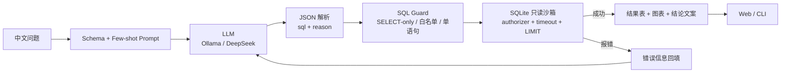

# DataPilot · 自然语言数据分析 Agent

> 用中文问业务问题，Agent 自动完成 **Schema 注入 → SQL 生成 → 只读沙箱执行 → 报错自纠错 → 表格/图表**。
> 零第三方 Python 依赖：Python 标准库 + SQLite + Ollama / 任意 OpenAI 兼容接口。

```text
$ python -m datapilot.cli ask "2026 年 10 月的销售额是多少？"

问题：2026 年 10 月的销售额是多少？
SQL：SELECT ROUND(SUM(oi.quantity * oi.unit_price * oi.discount), 2) AS sales
     FROM orders o JOIN order_items oi ON oi.order_id = o.order_id
     WHERE o.status = '已支付' AND o.order_date >= '2026-10-01' AND o.order_date < '2026-11-01'
结果：sales 为 288,159.58。
尝试：1 次｜耗时：8.4 s
```

## 为什么做这个项目

第一个项目（LLM Learning Lab）解决的是**非结构化文档**问题：问卷 → 学习路径、课程笔记 RAG、提示词评测。
这个项目换一条线，解决**结构化数据**问题：自然语言 → SQL → 真结果。

| | LLM Learning Lab（项目 1） | DataPilot（项目 2） |
|---|---|---|
| 数据 | 非结构化文档 | 结构化 SQLite 表 |
| 核心能力 | RAG、Prompt 评测 | Agent、工具调用、SQL 沙箱、自纠错 |
| 评测 | 关键词覆盖率 / 通过率 | 执行准确率（结果集比对） |
| 风险控制 | 引用越界校验 | 只读、白名单、LIMIT、超时 |

## 架构



## 功能

- **自然语言查数**：4 张表（客户 / 商品 / 订单 / 明细），覆盖 JOIN、分组、Top-N、窗口函数。
- **Agent 自纠错**：SQL 报错时把错误信息回填给模型，最多重试 3 次；记录每次尝试的 SQL / 错误 / 耗时。
- **SQL 安全沙箱**：只允许 SELECT/WITH；表白名单；单语句；SQLite `set_authorizer` 二次校验；自动 `LIMIT`；3 秒超时。
- **结果可视化**：标量显示大数字，时间序列画折线，分类对比画柱状；不引入前端框架。
- **离线评测**：30 条中文问题 + 标准 SQL，按结果集比对计算执行准确率、SQL 可执行率、自纠错成功率、平均延迟。
- **双模型后端**：本地 Ollama（默认 `qwen2.5-coder:1.5b`）或任何 OpenAI 兼容接口（DeepSeek / 通义）。
- **工程化**：CLI + Web + 22 个单测 + GitHub Actions + Dockerfile，全部零外部依赖。

## 快速开始

```bash
# 1. 准备本地模型（二选一）
ollama pull qwen2.5-coder:3b
# 或使用 DeepSeek：export LLM_PROVIDER=openai OPENAI_API_KEY=sk-...

# 2. 生成示例库
python scripts/build_db.py

# 3. 命令行问一句
python -m datapilot.cli ask "2026 年 10 月的销售额是多少？"

# 4. 跑 30 题评测
python -m datapilot.cli eval --output eval

# 5. Web 演示
python web/server.py --port 8000
# 打开 http://127.0.0.1:8000
```

环境变量见 `.env.example`；核心代码不依赖任何第三方包（Python ≥ 3.10）。

## 评测结果

<!--METRICS_START-->
测试环境：本地 Ollama `qwen2.5-coder:3b`（CPU），30 条中文问题，结果集比对。

| 指标 | 结果 |
|---|---|
| 执行准确率 | **73.33%**（22 / 30） |
| SQL 可执行率 | **96.67%** |
| 首次生成可执行率 | **83.33%** |
| 自纠错成功率 | **40.0%**（2/5 次失败后修复） |
| 平均尝试次数 | 1.2 |
| 平均延迟 | 11.99 s |

分难度：easy 70.0%（7/10）、medium 81.25%（13/16）、hard 50.0%（2/4）。

> 说明：这是 3B 本地模型在 CPU 上的结果；换成 DeepSeek / Qwen-7B 等 API 模型后，复杂 JOIN 和窗口函数题会明显提升。评测脚本可直接复跑，不依赖人工打分。
<!--METRICS_END-->

评测方式：对每个问题分别执行模型生成的 SQL 与标准 SQL，把结果集做归一化（浮点容差、顺序无关）后比较；列数不同或任一值不同即判错。

## SQL 安全设计

| 层 | 做法 |
|---|---|
| 词法 | 去注释、只允许单语句、必须 SELECT/WITH、禁用 DDL/DML/PRAGMA/ATTACH |
| 表白名单 | 只允许 `customers / products / orders / order_items`，CTE 名单独放行 |
| 引擎级 | `sqlite3` 只读连接 + `set_authorizer`，拒绝非 SELECT / 非白名单 READ |
| 资源 | 自动包一层 `LIMIT 201`；`set_progress_handler` 3 秒超时；最多返回 200 行 |

这套设计对应面试里常见的“Text-to-SQL 怎么防注入 / 怎么防止查崩库”。

## 项目结构

```
datapilot-agent/
├── datapilot/
│   ├── agent.py        # 生成 → 校验 → 执行 → 自纠错
│   ├── guard.py        # SQL 词法 / 白名单 / LIMIT
│   ├── db.py           # 只读连接、authorizer、schema 描述
│   ├── llm.py          # Ollama / OpenAI 兼容客户端
│   ├── prompts.py      # system prompt + few-shot
│   ├── evaluate.py     # 结果集比对 + 指标
│   └── cli.py          # ask / eval / schema
├── web/                # 零依赖 Web 演示（stdlib http.server）
├── data/               # schema.sql / shop.db / 30 条 questions.jsonl
├── scripts/build_db.py # 可复现的种子数据
├── tests/              # 22 个 unittest
├── eval/               # 评测报告
└── .github/workflows/ci.yml
```

## 设计取舍

- **为什么用 SQLite**：零部署、可复现、单文件；换 MySQL 只需改连接层和方言。
- **为什么让模型输出 JSON 而不是函数调用**：小模型 / 本地模型对原生 tool calling 支持参差；JSON 协议更稳，也方便做解析失败重试。
- **为什么自纠错只回填错误、不回填全量结果**：控制上下文长度和成本；错误信息足以修复大部分语法/列名问题。
- **为什么结果集比对而不是字符串比对 SQL**：同一语义可以写出不同 SQL，执行结果才是业务真相。
- **为什么零依赖**：保证在任何一台只有 Python 的机器上都能跑；Web 层用标准库，部署成本最低。

## 局限与后续

- 复杂多轮追问（“那上个月呢？”）还没做会话状态，可作为下一版。
- 只支持单库；多库路由 / 指标层（semantic layer）是自然扩展。
- 1.5B 本地模型在窗口函数、比率类问题上会错；换 DeepSeek / Qwen-7B 后准确率会明显上升，评测脚本可直接复跑。
- 可加：查询结果缓存、SQL 执行计划解释、失败案例回流到 few-shot。

## 简历写法（可直接用）

> **DataPilot · 自然语言数据分析 Agent**｜个人项目｜2026.11 – 至今
> Python · SQLite · Ollama / DeepSeek · 原生 HTTP · GitHub Actions
> · 独立开发 NL2SQL Agent：中文问题 → Schema 注入 → SQL 生成 → 只读沙箱执行 → 报错自纠错 → 表格/图表，支持本地 Ollama 与 OpenAI 兼容接口双后端
> · 设计 SQL 安全沙箱（SELECT-only、表白名单、单语句、自动 LIMIT、3s 超时、SQLite authorizer），拦截 DDL/DML/多语句注入
> · 自建 30 条中文评测集，执行准确率 **__%**、SQL 可执行率 **__%**、自纠错成功率 **__%**、平均延迟 **__s**
> · 工程化：CLI + Web + 22 个单测 + GitHub Actions 双版本 CI + Dockerfile，核心零第三方依赖

## License

MIT
